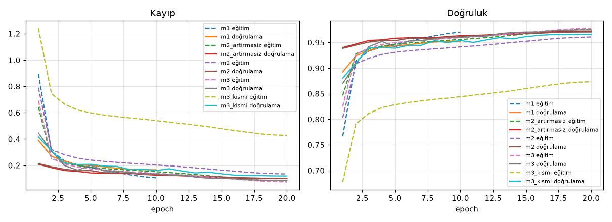
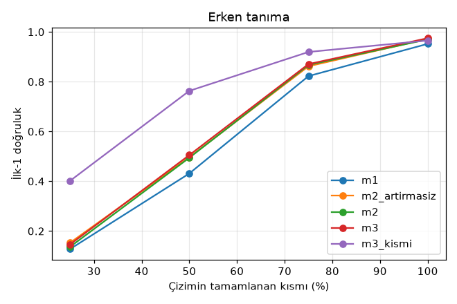
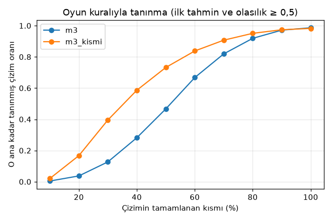

# CNN Tabanlı Gerçek Zamanlı Çizim Tanıma Oyunu

Taslak. Sayılar `deneyler/sonuclar.json` ve `deneyler/gercek.json` dosyalarından alınmıştır; şekiller `deneyler/` altındadır.

## 1. Giriş

Bu çalışmada, kullanıcının ekrana çizdiği nesneyi çizim sürerken tanıyan evrişimli sinir ağı (CNN) tabanlı bir oyun geliştirilmiştir. Oyunda oyuncuya bir nesne adı verilir; oyuncu 20 saniye içinde nesneyi çizer ve model çizimi tanıdığı anda, kalan süreyle orantılı puan kazanılır. Bu nedenle model yalnız tamamlanmış çizimleri değil, yarım çizimleri de olabildiğince erken tanımalıdır.

Hedefler:

1. Google Quick, Draw! veri setinin seçilmiş 50 sınıfında yüksek doğrulukla sınıflandırma yapan bir CNN eğitmek.
2. Farklı karmaşıklıktaki üç mimariyi doğruluk, model boyutu ve tahmin süresi açısından karşılaştırmak.
3. Modelin tarayıcıda, sunucuya ihtiyaç duymadan gerçek zamanlı çalışmasını sağlamak.
4. Erken tanıma başarımını (çizimin bir kısmıyla doğruluk) ölçmek ve iyileştirmek.

## 2. Veri seti ve ön işleme

### 2.1. Quick, Draw!

Quick, Draw! veri seti, 345 sınıfta 50 milyondan fazla çizim içerir. Her çizim, kullanıcının kalem vuruşlarının (stroke) nokta dizileri olarak saklanır. Bu çalışmada `simplified` sürüm kullanılmıştır. Bu sürümde çizimler 0–255 aralığına ölçeklenmiş ve Ramer–Douglas–Peucker (RDP) algoritmasıyla sadeleştirilmiştir. Her kayıtta, çizimin Google'ın kendi modeli tarafından tanınıp tanınmadığını gösteren `recognized` alanı bulunur.

### 2.2. Sınıf seçimi

345 sınıf içinden 50 sınıf seçilmiştir (`egitim/siniflar.py`). Seçimde üç ölçüt kullanılmıştır: nesne 20 saniyede çizilebilmeli, birbirine çok benzeyen sınıflar birlikte alınmamalı (ör. kupa / kahve fincanı) ve nesnenin Türkçe adı açık olmalıdır.

### 2.3. Bölümleme

Her sınıftan yalnız `recognized = true` olan çizimler alınmış, sabit tohumla karıştırılıp sınıf başına 30 000 eğitim, 5 000 doğrulama ve 5 000 test çizimi ayrılmıştır. Toplam 1,5 milyon eğitim, 250 bin doğrulama ve 250 bin test örneği vardır. Sınıflar dengelidir.

### 2.4. Vuruşlardan görüntüye

Veri setinin hazır 28×28 görüntü sürümü (`numpy_bitmap`) kullanılmamıştır. Bunun nedeni, oyunda kullanıcının çizimini aynı yöntemle görüntüye çevirme imkânının olmamasıdır. Eğitimdeki görüntüler ile oyundaki görüntüler arasındaki fark, modelin gerçek kullanımda başarımını düşürür. Bunun yerine vuruşlardan görüntü üreten tek bir algoritma yazılmış ve hem eğitimde (Python) hem tarayıcıda (TypeScript) birebir uygulanmıştır:

1. Bütün noktaların sınır kutusu bulunur; çizim sol üst köşeye kaydırılır ve uzun kenarı 255 olacak biçimde en-boy oranı korunarak ölçeklenir.
2. Her vuruş RDP ile ε = 2,0 değerinde sadeleştirilir (veri setiyle aynı değer).
3. Çizim 28×28 tuvalde 2 piksel kenar payıyla ortalanır.
4. Her pikselin değeri, piksel merkezinin en yakın doğru parçasına uzaklığına (d) göre belirlenir: v = sınırla(1,5 − d, 0, 1). Bu, yaklaşık 2 piksel kalınlığında, kenarları yumuşatılmış çizgiler üretir.

İki uygulamanın eşitliği, 304 örnek (50 sınıftan tam ve yarım çizimler, uç durumlar) üzerinde test edilmiş ve bütün piksellerin bayt düzeyinde aynı olduğu görülmüştür (`demo/test/esitlik.ts`).

### 2.5. Yarım çizimler

Erken tanımayı ölçmek için her çizimin mürekkebinin (nokta sayısının) ilk %25, %50 ve %75'i alınarak görüntü üretilmiştir. Yarım çizim de aynı ön işlemeden geçer; yani oyundaki gibi, o ana kadar çizilmiş kısım kendi sınır kutusuna göre ölçeklenir. Ölçüm, test setinde sınıf başına 1000 çizimle (toplam 50 000) yapılmıştır.

## 3. Modeller

| Model | Yapı | Parametre |
| --- | --- | ---: |
| M1 — Basit CNN | 2 × (3×3 evrişim, ReLU, 2×2 maks. havuzlama), 128 nöronlu tam bağlı katman | 426 802 |
| M2 — Derin CNN | 3 blok × (2 × [3×3 evrişim, BatchNorm, ReLU], havuzlama, Dropout2d 0,1), 256 nöronlu tam bağlı katman, Dropout 0,4 | 595 154 |
| M3 — Hafif ResNet | Giriş evrişimi + 3 aşama × 2 artık blok (32/64/128 kanal), küresel ortalama havuzlama, Dropout 0,2 | 701 202 |
| M3-kısmi | M3 ile aynı mimari; eğitimde her yığındaki örneklerin yarısı yarım çizim sürümüyle değiştirilir (§4.5) | 701 202 |

M2 hem veri artırmasız hem veri artırmayla eğitilmiştir; böylece düzenlileştirme katmanlarının ve veri artırmanın etkisi ayrı ayrı görülebilmektedir.

**Veri artırma** (GPU'da, her yığında rastgele): ±15° döndürme, 0,85–1,15 ölçekleme, ±2 piksel kaydırma. Ön işleme çizgi kalınlığını sabitlediği için kalınlık artırması kullanılmamıştır.

**Eğitim ayarları:** AdamW (ağırlık azalması 0,05), tek döngülü (one-cycle) öğrenme oranı, en yüksek oran 0,003, yığın boyutu 512, bfloat16 karışık hassasiyet, M1 için 10, diğerleri için 20 epoch. Her epoch sonunda doğrulama doğruluğu ölçülmüş ve en iyi epoch'un ağırlıkları saklanmıştır. Test seti yalnız son değerlendirmede kullanılmıştır. Donanım: NVIDIA RTX 5070 Ti (16 GB), PyTorch 2.11 (CUDA 12.8).

## 4. Sonuçlar

### 4.1. Test doğruluğu

Test seti: 250 000 çizim (sınıf başına 5 000), eğitimde ve model seçiminde hiç kullanılmadı.

| Model | Parametre | İlk-1 doğruluk | İlk-3 doğruluk | ONNX boyutu | CPU tahmin süresi* |
| --- | ---: | ---: | ---: | ---: | ---: |
| M1 Basit CNN | 426 802 | %95,22 | %98,81 | 1,7 MB | 0,06 ms |
| M2 Derin CNN (artırmasız) | 595 154 | %97,13 | %99,35 | 2,3 MB | 0,24 ms |
| M2 Derin CNN (artırmalı) | 595 154 | %96,94 | %99,33 | 2,3 MB | 0,24 ms |
| M3 Hafif ResNet | 701 202 | **%97,43** | **%99,46** | 2,7 MB | 0,60 ms |
| M3-kısmi | 701 202 | %96,50 | %99,22 | 2,7 MB | 0,60 ms |

\* ONNX Runtime (Python), tek iş parçacığı, tek görüntü, 500 tekrar ortalaması.

M1'den M2'ye geçiş (BatchNorm, daha fazla evrişim katmanı, Dropout) hatayı %4,78'den %2,87'ye indirmiştir. Artık bağlantılı M3 en yüksek doğruluğa ulaşmış, ancak kazanç M2'ye göre küçük kalmıştır (0,3 puan). Buna karşılık M3'ün tahmin süresi M2'nin 2,5 katıdır.

### 4.2. Öğrenme eğrileri

M1'de eğitim doğruluğu (%97,0) ile doğrulama doğruluğu (%95,2) arasındaki fark son epoch'larda açılmaktadır; basit model aşırı öğrenmeye başlamıştır. M2 ve M3'te iki eğri birbirine yakındır. Veri artırmalı M2'nin eğitim doğruluğu doğrulama doğruluğunun altındadır, çünkü artırılmış örnekler orijinallerden daha zordur ve Dropout eğitim sırasında etkindir.

### 4.3. Veri artırmanın etkisi

Veri artırma, M2'nin test doğruluğunu %97,13'ten %96,94'e düşürmüştür (−0,19 puan). Sınıf başına 30 000 çizim, döndürme ve ölçek çeşitliliğini zaten içerdiği için, aynı dağılımdan gelen test setinde artırmanın katkısı görülmemiştir. Artırmanın asıl beklenen yararı, veri setinden farklı koşullarda (fare, telefon, farklı çizim alışkanlıkları) çizilen gerçek kullanıcı çizimlerindedir (§4.7).

### 4.4. Karışan sınıflar

M3'te en çok karışan çiftler (5 000 test çiziminde):

| Gerçek | Tahmin | Sayı |
| --- | --- | ---: |
| ay | muz | 367 |
| muz | ay | 204 |
| örümcek | güneş | 141 |
| mantar | şemsiye | 124 |
| güneş | örümcek | 108 |
| ay | pizza | 94 |
| dondurma | elmas | 69 |
| ağaç | mantar | 67 |

Karışıklıklar şekil benzerliğinden kaynaklanmaktadır: hilal biçimli ay ile muz, ortasından çizgiler çıkan daire biçimindeki güneş ile örümcek, kubbe ve sap yapısındaki mantar ile şemsiye. "Ay → pizza" karışıklığı, dilim biçiminde çizilen aylardan gelmektedir. En zor sınıflar ay (%88,4), mantar (%93,0) ve kuş (%93,1); en kolaylar merdiven, tişört, ev ve zarftır (%99,2).

### 4.5. Erken tanıma

Çizimin yalnız ilk %25, %50 ve %75'i (mürekkep oranı) verildiğinde ilk-1 doğruluk (sınıf başına 1 000, toplam 50 000 test çizimi):

| Model | %25 | %50 | %75 | %100 |
| --- | ---: | ---: | ---: | ---: |
| M1 | %12,8 | %43,1 | %82,3 | %95,2 |
| M2 (artırmasız) | %15,3 | %49,7 | %86,2 | %97,1 |
| M2 (artırmalı) | %13,7 | %49,5 | %86,7 | %96,9 |
| M3 | %14,7 | %50,5 | %87,1 | %97,4 |
| M3-kısmi | **%40,2** | **%76,3** | **%91,9** | %96,5 |

İlk dört model yalnız tamamlanmış çizimlerle eğitildiği için yarım çizimlerde başarısızdır; mimari farkı bu sorunu çözmemektedir. Bu nedenle M3, eğitim verisine yarım çizimler eklenerek yeniden eğitilmiştir (M3-kısmi): her eğitim çizimi için mürekkebin rastgele %20–100'ü alınarak bir yarım sürüm üretilmiş (`egitim/kismi_hazirla.py`), her yığında örneklerin yarısı bu sürümle değiştirilmiştir. Etiketler aynı kalmıştır. Sonuçta yarım çizimdeki doğruluk %25 mürekkepte 2,7 katına, %50'de 1,5 katına çıkmış, tam çizimdeki doğruluk ise yalnız 0,9 puan düşmüştür.

### 4.6. Oyun simülasyonu

Oyun kuralıyla (hedef birinci tahmin ve olasılığı ≥ 0,5) her test çizimi %10'luk adımlarla ilerletilmiş ve ilk tanındığı adım kaydedilmiştir (sınıf başına 200, toplam 10 000 çizim; §4.5'te kullanılmayan çizimler).

| Model | Tanınan çizim | Ortalama tanınma anı | Medyan tanınma anı |
| --- | ---: | ---: | ---: |
| M3 | %98,7 | mürekkebin %56'sı | %60 |
| M3-kısmi | %98,2 | mürekkebin %43'ü | %40 |

M3-kısmi çizimleri ortalama 13 puan, medyanda 20 puan daha erken tanımaktadır. Puan kalan süreyle orantılı olduğundan, oyunda M3-kısmi kullanılmıştır.

### 4.7. Gerçek kullanıcı çizimleri

**Ön deneme (oyun, tek kullanıcı, fare):** 9 turda 7 çizim tanınmıştır (%77,8); tanınan çizimlerde ortalama tanınma süresi 4,1 sn'dir (en kısa 2,6 sn, zarf; en uzun 5,7 sn, bisiklet). Tanınmayan iki çizimin incelemesi:

- *Gökkuşağı*, kavisler yerine çapraz düz çizgilerle çizilmiş ve model %72 olasılıkla "şimşek" demiştir; oyuncu 8,6 sn'de turu geçmiştir.
- *Şapka* çizimi şapkadan çok bir çubuk insana benzemektedir; modelin ilk tahmini "ampul" (%38) olmuş ve süre dolmuştur.

Her iki hata da, çizimin veri setindeki tipik çizim biçiminden uzak olmasından kaynaklanmaktadır.

Örnek çok küçük (9 tur, tek kişi) olduğu için bu sonuç genellenemez. Oyun kayıtları tanındığı anda kesildiği için doğruluk ölçümüne katılmaz. Asıl ölçüm, Serbest çizim bölümünde etiketlenip kaydedilen tam çizimlerle `egitim/gercek_degerlendir.py` kullanılarak yapılacak ve Quick, Draw! test doğruluğuyla karşılaştırılacaktır. Bunun için sınıf başına birkaç çizim, farklı kişilerden ve hem fareyle hem telefonla çizilmiş olması gerekir.

## 5. Tarayıcıda gerçek zamanlı tahmin

Eğitilen modeller ONNX biçimine aktarılmış (softmax dahil) ve tarayıcıda ONNX Runtime Web (WebAssembly, tek iş parçacığı) ile çalıştırılmıştır. Aktarımın doğruluğu, PyTorch ve ONNX Runtime çıktılarının aynı girişlerdeki en büyük mutlak farkıyla kontrol edilmiştir.

Oyunda tahmin, kullanıcı çizerken en fazla 250 ms'de bir ve her vuruşun sonunda yapılır. Bir tahmin sürerken gelen istekler birleştirilir ve tahmin bitince bir kez daha çalıştırılır. Çizim, hedef sınıf modelin birinci tahmini olduğunda ve olasılığı en az 0,5 olduğunda tanınmış sayılır. Puan, kalan süreyle orantılıdır: puan = 100 × kalan süre / 20 sn.

ONNX aktarımında PyTorch ile ONNX Runtime çıktıları arasındaki en büyük mutlak fark bütün modellerde 6 × 10⁻⁷'nin altındadır.

Tarayıcıda tek tahmin süresi (masaüstü Chromium, WebAssembly, tek iş parçacığı, 200 tekrar ortalaması, ön işleme hariç):

| Model | Süre |
| --- | ---: |
| M1 | 0,29 ms |
| M2 | 1,66 ms |
| M3 / M3-kısmi | 4,3 ms |

Ön işleme dahil bir tahmin M3-kısmi ile yaklaşık 5 ms sürmektedir. Bu, 250 ms'lik tahmin aralığının %2'si kadardır; model tarayıcıda gerçek zamanlı çalışmak için yeterince hızlıdır. Telefon tarayıcısındaki süre bu taslakta ölçülmemiştir.

## 6. Oyun

Demo iki bölümden oluşur:

- **Oyun:** 5 tur, her turda rastgele ve tekrarsız bir nesne, 20 saniye. Oyuncu çizerken modelin tahmini ("Yapay zekâ: kedi mi? %62 · yoksa kuş mu?") ekranda canlı görünür. Tanınınca çizim kilitlenir ve puan gösterilir; maç sonunda turların listesi ve toplam puan çıkar.
- **Serbest çizim:** İlk beş tahmin ve olasılıkları, modelin gördüğü 28×28 görüntü, model seçimi, tarayıcıda hız testi ve rapor için çizim kaydetme.

Demo, CepKonsol çok oyunculu platformuna "Çizim Düellosu" oyunu olarak eklenecek biçimde tasarlanmıştır: ön işleme, model ve oyun kuralları arayüzden bağımsız modüllerdedir.

## 7. Sınırlılıklar ve gelecek çalışmalar

- **Gerçek kullanıcı ölçümü yapılmadı** (§4.7). Quick, Draw! test setindeki doğruluk, veri setiyle aynı dağılımdan gelir; oyuncuların fare ve telefonla çizdiklerinde doğruluk düşebilir.
- **Veri yanlılığı:** yalnız Google'ın kendi modelinin tanıdığı çizimler (`recognized = true`) kullanıldı. Bu, kötü ya da yarım bırakılmış çizimleri veri setinden çıkarır ve test doğruluğunu iyimser gösterebilir.
- **Anlamsız karalama** da 50 sınıftan birine atanır. Oyunda yalnız hedef sınıf için olasılık eşiği kullanıldığından bu oyunu bozmaz, ama serbest çizimde yanıltıcı tahminler görülebilir. Bir "karalama" sınıfı eklenebilir.
- **Sınıf sayısı 50 ile sınırlıdır.** Sınıf sayısı arttıkça benzer sınıflar çoğalır ve doğruluk düşer.
- **Telefon tarayıcısında tahmin süresi** ölçülmedi.
- **Gelecek çalışmalar:** vuruş sırasını doğrudan kullanan modellerle (RNN/Transformer) karşılaştırma; yarım çizim oranının ve eğitimdeki karışım oranının ayarlanması; modelin 8 bit tamsayıya nicemlenmesi (boyut ve hız); CepKonsol'da çok oyunculu "Çizim Düellosu" (telefonlarda çizim, ortak ekranda canlı tahmin).
