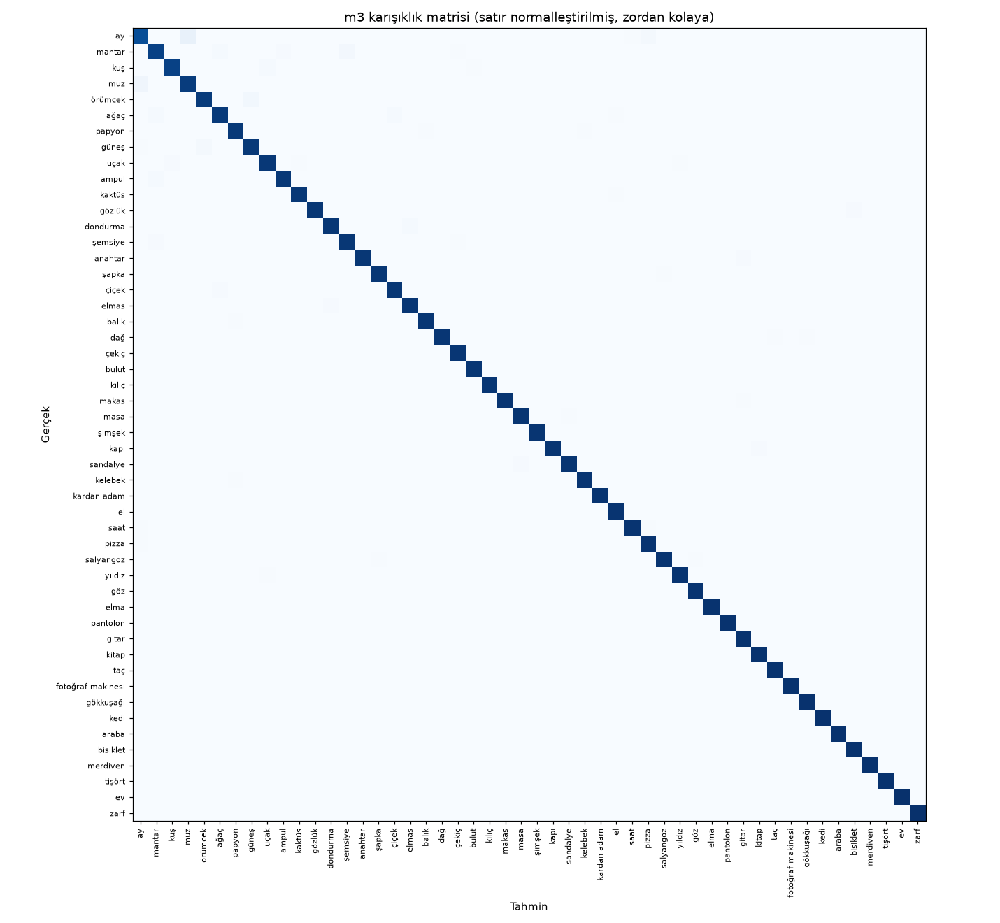
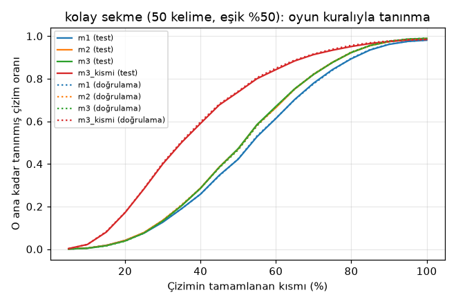
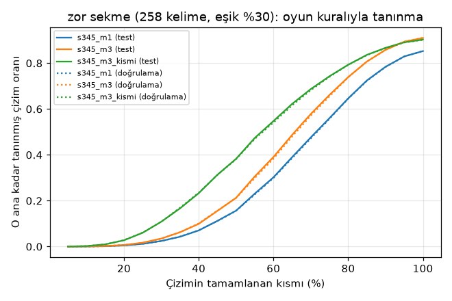

# CNN Tabanlı Gerçek Zamanlı Çizim Tanıma Oyunu

## Özet

Bu çalışmada, oyuncunun ekrana çizdiği nesneyi çizim sürerken tanıyan, tarayıcıda çalışan bir çizim oyunu için evrişimli sinir ağları (CNN) geliştirilmiş ve karşılaştırılmıştır. Google Quick, Draw! veri setinin vuruş verisinden, eğitimde ve tarayıcıda birebir aynı çalışan bir ön işlemeyle 28×28 görüntüler üretilmiştir. Seçilmiş 50 sınıfta üç mimari (basit CNN, BatchNorm ve Dropout'lu derin CNN, hafif ResNet) eğitilmiş; en iyi model test setinde %97,4 ilk-1 doğruluğa ulaşmıştır. Tamamlanmış çizimlerle eğitilen modeller yarım çizimlerde başarısız olduğundan (mürekkebin %25'inde %15), eğitime yarım çizimler eklenmiştir. Bu model (M3-kısmi) tam çizimde 0,9 puan kaybederken %25 mürekkepte doğruluğu %40'a çıkarmıştır. Yöntem 345 sınıfın tamamına ölçeklendiğinde doğruluk %77'ye düşmüş; düşüşün büyük kısmının birbirine benzeyen ya da aynı nesnenin farklı adı olan sınıflardan geldiği gösterilmiştir. Modeller ONNX biçiminde tarayıcıda tek tahmini yaklaşık 5 ms'de yapmaktadır. Modeller ayrıca oyunun kendi kuralıyla, seçim için doğrulama ve son ölçüm için test çizimleri ayrılarak değerlendirilmiştir. M3-kısmi, toplamda biraz daha az çizim tanımasına rağmen erken tanıdığı için oyun puanında açık farkla öndedir. Benzer nesnelerin birbirinin yerine kabul edilmesi ise bu erken kararın bedelidir. Beş katılımcıdan toplanan 229 gerçek çizimde doğruluk, test setine göre 50 sınıfta 9–13, 345 sınıfta 14–18 puan düşüktür.

*Sayılar `deneyler/sonuclar.json`, `deneyler/sonuclar345.json`, `deneyler/gercek.json` ve `deneyler/olcum.json` dosyalarından alınmıştır; şekiller `deneyler/` altındadır. Köşeli parantezli numaralar §9'daki kaynaklardır.*

## 1. Giriş

Bu çalışmada, kullanıcının ekrana çizdiği nesneyi çizim sürerken tanıyan evrişimli sinir ağı (CNN) tabanlı bir oyun geliştirilmiştir. Oyunda oyuncuya bir nesne adı verilir; oyuncu 20 saniye içinde nesneyi çizer ve model çizimi tanıdığı anda, kalan süreyle orantılı puan kazanılır. Bu nedenle model yalnız tamamlanmış çizimleri değil, yarım çizimleri de olabildiğince erken tanımalıdır.

Hedefler:

1. Google Quick, Draw! veri setinin seçilmiş 50 sınıfında yüksek doğrulukla sınıflandırma yapan bir CNN eğitmek.
2. Farklı karmaşıklıktaki üç mimariyi doğruluk, model boyutu ve tahmin süresi açısından karşılaştırmak.
3. Modelin tarayıcıda, sunucuya ihtiyaç duymadan gerçek zamanlı çalışmasını sağlamak.
4. Erken tanıma başarımını (çizimin bir kısmıyla doğruluk) ölçmek ve iyileştirmek.
5. Yöntemi veri setinin 345 sınıfının tamamına ölçeklendirip sınıf sayısının doğruluğa ve oyuna etkisini ölçmek.

### 1.1. İlgili çalışmalar

Elle çizilmiş eskiz tanıma, fotoğraf tanımadan farklıdır: eskizler seyrek, soyut ve çizen kişiye göre çok değişkendir. Eitz ve arkadaşları 250 sınıflık ve 20 000 eskizlik bir veri seti toplamış, insanların bu eskizleri yaklaşık %73 doğrulukla tanıdığını göstermiştir [4]. Bu veri setinde, eskizlere özgü tasarlanmış bir CNN olan Sketch-a-Net'in insan doğruluğunu geçtiği bildirilmiştir [5]. Quick, Draw! [1] ise oyuncunun 20 saniyede çizdiği nesneyi çizim sırasında tahmin eden bir çevrimiçi oyundur. Oyunun topladığı 50 milyondan fazla çizim 345 sınıflık açık bir veri seti olarak yayımlanmıştır [2]. Bu veri seti, çizimi vuruş dizisi olarak modelleyen üretici bir yinelemeli ağ olan Sketch-RNN'in eğitiminde de kullanılmıştır [3].

Bu çalışma görüntü tabanlı sınıflandırmayı kullanır. Vuruşlar el yazısı rakam tanımadaki gibi [6] küçük bir görüntüye çevrilir ve hafif CNN'lerle sınıflandırılır. Literatürdeki çalışmalardan farkı üç noktadadır: model tarayıcıda, sunucusuz ve gerçek zamanlı çalışır; yarım çizimle eğitimle erken tanıma iyileştirilir; modeller yalnız sınıflandırma doğruluğuyla değil, oyunun kendi kuralı, puanı ve kandırılabilirliğiyle de değerlendirilir.

## 2. Veri seti ve ön işleme

### 2.1. Quick, Draw!

Quick, Draw! veri seti [1, 2], 345 sınıfta 50 milyondan fazla çizim içerir. Her çizim, kullanıcının kalem vuruşlarının (stroke) nokta dizileri olarak saklanır. Bu çalışmada `simplified` sürüm kullanılmıştır. Bu sürümde çizimler 0–255 aralığına ölçeklenmiş ve Ramer–Douglas–Peucker (RDP) algoritmasıyla [12, 13] sadeleştirilmiştir. Her kayıtta, çizimin Google'ın kendi modeli tarafından tanınıp tanınmadığını gösteren `recognized` alanı bulunur.

### 2.2. Sınıf seçimi

345 sınıf içinden 50 sınıf seçilmiştir (`egitim/siniflar.py`). Seçimde üç ölçüt kullanılmıştır: nesne 20 saniyede çizilebilmeli, birbirine çok benzeyen sınıflar birlikte alınmamalı (ör. kupa / kahve fincanı) ve nesnenin Türkçe adı açık olmalıdır.

### 2.3. Bölümleme

Her sınıftan yalnız `recognized = true` olan çizimler alınmış, sabit tohumla karıştırılıp sınıf başına 30 000 eğitim, 5 000 doğrulama ve 5 000 test çizimi ayrılmıştır. Toplam 1,5 milyon eğitim, 250 bin doğrulama ve 250 bin test örneği vardır. Sınıflar dengelidir.

Model eğitiminde en iyi epoch doğrulama doğruluğuyla seçilmiştir. Oyuna ilişkin seçimler de (tanınma eşiği, oyun modeli, oyunda sorulan kelimeler, eşdeğer gruplar; §4.6, §4.8, §6) doğrulama çizimleriyle yapılmıştır. Test çizimleri yalnız son ölçümde kullanılmıştır.

### 2.4. Vuruşlardan görüntüye

Veri setinin hazır 28×28 görüntü sürümü (`numpy_bitmap`) kullanılmamıştır. Bunun nedeni, oyunda kullanıcının çizimini aynı yöntemle görüntüye çevirme imkânının olmamasıdır. Eğitimdeki görüntüler ile oyundaki görüntüler arasındaki fark, modelin gerçek kullanımda başarımını düşürür. Bunun yerine vuruşlardan görüntü üreten tek bir algoritma yazılmış ve hem eğitimde (Python) hem tarayıcıda (TypeScript) birebir uygulanmıştır:

1. Bütün noktaların sınır kutusu bulunur; çizim sol üst köşeye kaydırılır ve uzun kenarı 255 olacak biçimde en-boy oranı korunarak ölçeklenir.
2. Her vuruş RDP ile ε = 2,0 değerinde sadeleştirilir (veri setiyle aynı değer).
3. Çizim 28×28 tuvalde 2 piksel kenar payıyla ortalanır.
4. Her pikselin değeri, piksel merkezinin en yakın doğru parçasına uzaklığına (d) göre belirlenir: v = sınırla(1,5 − d, 0, 1). Bu, yaklaşık 2 piksel kalınlığında, kenarları yumuşatılmış çizgiler üretir.

İki uygulamanın eşitliği, 304 örnek (50 sınıftan tam ve yarım çizimler, uç durumlar) üzerinde test edilmiş ve bütün piksellerin bayt düzeyinde aynı olduğu görülmüştür (`demo/test/esitlik.ts`).

### 2.5. Yarım çizimler

Erken tanımayı ölçmek için her çizimin mürekkebinin (nokta sayısının) ilk %25, %50 ve %75'i alınarak görüntü üretilmiştir. Yarım çizim de aynı ön işlemeden geçer; yani oyundaki gibi, o ana kadar çizilmiş kısım kendi sınır kutusuna göre ölçeklenir. Ölçüm, test setinde sınıf başına 1000 çizimle (toplam 50 000) yapılmıştır.

## 3. Modeller

| Model | Yapı | Parametre |
| --- | --- | ---: |
| M1 — Basit CNN | 2 × (3×3 evrişim, ReLU, 2×2 maks. havuzlama), 128 nöronlu tam bağlı katman | 426 802 |
| M2 — Derin CNN | 3 blok × (2 × [3×3 evrişim, BatchNorm [8], ReLU], havuzlama, Dropout2d 0,1), 256 nöronlu tam bağlı katman, Dropout [9] 0,4 | 595 154 |
| M3 — Hafif ResNet [7] | Giriş evrişimi + 3 aşama × 2 artık blok (32/64/128 kanal), küresel ortalama havuzlama, Dropout 0,2 | 701 202 |
| M3-kısmi | M3 ile aynı mimari; eğitimde her yığındaki örneklerin yarısı yarım çizim sürümüyle değiştirilir (§4.5) | 701 202 |

M2 hem veri artırmasız hem veri artırmayla eğitilmiştir; böylece düzenlileştirme katmanlarının ve veri artırmanın etkisi ayrı ayrı görülebilmektedir.

**Veri artırma** [21] (GPU'da, her yığında rastgele): ±15° döndürme, 0,85–1,15 ölçekleme, ±2 piksel kaydırma. Ön işleme çizgi kalınlığını sabitlediği için kalınlık artırması kullanılmamıştır.

**Eğitim ayarları:** AdamW [10] (ağırlık azalması 0,05), tek döngülü (one-cycle) öğrenme oranı [11], en yüksek oran 0,003, yığın boyutu 512, bfloat16 karışık hassasiyet, M1 için 10, diğerleri için 20 epoch. Her epoch sonunda doğrulama doğruluğu ölçülmüş ve en iyi epoch'un ağırlıkları saklanmıştır. Test seti yalnız son değerlendirmede kullanılmıştır. Donanım: NVIDIA RTX 5070 Ti (16 GB), PyTorch 2.11 [14] (CUDA 12.8).

## 4. Sonuçlar

### 4.1. Test doğruluğu

Test seti: 250 000 çizim (sınıf başına 5 000), eğitimde ve model seçiminde hiç kullanılmadı.

| Model | Parametre | İlk-1 doğruluk | İlk-3 doğruluk | ONNX boyutu | CPU tahmin süresi* |
| --- | ---: | ---: | ---: | ---: | ---: |
| M1 Basit CNN | 426 802 | %95,22 | %98,81 | 1,7 MB | 0,06 ms |
| M2 Derin CNN (artırmasız) | 595 154 | %97,13 | %99,35 | 2,3 MB | 0,24 ms |
| M2 Derin CNN (artırmalı) | 595 154 | %96,94 | %99,33 | 2,3 MB | 0,24 ms |
| M3 Hafif ResNet | 701 202 | **%97,43** | **%99,46** | 2,7 MB | 0,60 ms |
| M3-kısmi | 701 202 | %96,50 | %99,22 | 2,7 MB | 0,60 ms |

\* ONNX Runtime (Python), tek iş parçacığı, tek görüntü, 500 tekrar ortalaması.

M1'den M2'ye geçiş (BatchNorm, daha fazla evrişim katmanı, Dropout) hatayı %4,78'den %2,87'ye indirmiştir. Artık bağlantılı M3 en yüksek doğruluğa ulaşmış, ancak kazanç M2'ye göre küçük kalmıştır (0,3 puan). Buna karşılık M3'ün tahmin süresi M2'nin 2,5 katıdır.

### 4.2. Öğrenme eğrileri

M1'de eğitim doğruluğu (%97,0) ile doğrulama doğruluğu (%95,2) arasındaki fark son epoch'larda açılmaktadır; basit model aşırı öğrenmeye başlamıştır. M2 ve M3'te iki eğri birbirine yakındır. Veri artırmalı M2'nin eğitim doğruluğu doğrulama doğruluğunun altındadır, çünkü artırılmış örnekler orijinallerden daha zordur ve Dropout eğitim sırasında etkindir.

### 4.3. Veri artırmanın etkisi

Veri artırma, M2'nin test doğruluğunu %97,13'ten %96,94'e düşürmüştür (−0,19 puan). Sınıf başına 30 000 çizim, döndürme ve ölçek çeşitliliğini zaten içerdiği için, aynı dağılımdan gelen test setinde artırmanın katkısı görülmemiştir. Artırmanın asıl beklenen yararı, veri setinden farklı koşullarda (fare, telefon, farklı çizim alışkanlıkları) çizilen gerçek kullanıcı çizimlerindedir (§4.7).

### 4.4. Karışan sınıflar

M3'te en çok karışan çiftler (5 000 test çiziminde):

| Gerçek | Tahmin | Sayı |
| --- | --- | ---: |
| ay | muz | 367 |
| muz | ay | 204 |
| örümcek | güneş | 141 |
| mantar | şemsiye | 124 |
| güneş | örümcek | 108 |
| ay | pizza | 94 |
| dondurma | elmas | 69 |
| ağaç | mantar | 67 |

Karışıklıklar şekil benzerliğinden kaynaklanmaktadır: hilal biçimli ay ile muz, ortasından çizgiler çıkan daire biçimindeki güneş ile örümcek, kubbe ve sap yapısındaki mantar ile şemsiye. "Ay → pizza" karışıklığı, dilim biçiminde çizilen aylardan gelmektedir. En zor sınıflar ay (%88,4), mantar (%93,0) ve kuş (%93,1); en kolaylar el merdiveni, tişört, ev ve zarftır (%99,2).

### 4.5. Erken tanıma

Çizimin yalnız ilk %25, %50 ve %75'i (mürekkep oranı) verildiğinde ilk-1 doğruluk (sınıf başına 1 000, toplam 50 000 test çizimi):

| Model | %25 | %50 | %75 | %100 |
| --- | ---: | ---: | ---: | ---: |
| M1 | %12,8 | %43,1 | %82,3 | %95,2 |
| M2 (artırmasız) | %15,3 | %49,7 | %86,2 | %97,1 |
| M2 (artırmalı) | %13,7 | %49,5 | %86,7 | %96,9 |
| M3 | %14,7 | %50,5 | %87,1 | %97,4 |
| M3-kısmi | **%40,2** | **%76,3** | **%91,9** | %96,5 |

İlk dört model yalnız tamamlanmış çizimlerle eğitildiği için yarım çizimlerde başarısızdır; mimari farkı bu sorunu çözmemektedir. Bu nedenle M3, eğitim verisine yarım çizimler eklenerek yeniden eğitilmiştir (M3-kısmi): her eğitim çizimi için mürekkebin rastgele %20–100'ü alınarak bir yarım sürüm üretilmiş (`egitim/kismi_hazirla.py`), her yığında örneklerin yarısı bu sürümle değiştirilmiştir. Etiketler aynı kalmıştır. Sonuçta yarım çizimdeki doğruluk %25 mürekkepte 2,7 katına, %50'de 1,5 katına çıkmış, tam çizimdeki doğruluk ise yalnız 0,9 puan düşmüştür.

### 4.6. Oyun kuralıyla ölçüm

Sınıflandırma doğruluğu, oyunun asıl sorusunu yanıtlamaz: oyunda bir çizim, çizim sürerken herhangi bir anda kabul edilebilir ve puan, tanınma anına bağlıdır. Bu nedenle modeller oyunun kendi kuralıyla da ölçülmüştür (`egitim/olcum.py`; kural `egitim/oyun_kurali.py`, oyundaki `demo/src/oyun.ts` ile aynı, eşitliği `npm test` ile denetlenir).

**Kural.** Modelin birinci tahmini hedefin eşdeğer grubundaysa ve grubun olasılıkları toplamı eşiği geçiyorsa çizim tanınır. Eşdeğer gruplar yalnız 345 sınıflı modelde anlamlıdır (§4.8); grubu olmayan sınıf tek başına bir gruptur ve kural "hedef birinci, olasılığı ≥ eşik" olur. Eşik 50 sınıfta 0,5, 345 sınıfta 0,3'tür (§6).

**Yöntem.** Her çizim mürekkebin (nokta sayısının) %5'lik adımlarıyla ilerletilir; oyun 250 ms'de bir ve her vuruşun sonunda tahmin yaptığı için bu, 5–10 sn'lik bir çizimde oyundaki 20–40 tahmine karşılık gelir. İlk kabul edilen adım tanınma anıdır. Quick, Draw! çizimlerinde zaman bilgisi olmadığından her çizime bir çizim süresi T atanır: arkadaşlardan toplanan 228 çizimin süre dağılımından (medyan 11 sn) örneklenir ve tur süresiyle (20 sn) sınırlanır; mürekkebin f oranında tanınan çizim f·T anında tanınmış sayılır. Aynı çizime bütün modellerde aynı T verilir, böylece modeller aynı çizimler üzerinde eşleştirilerek karşılaştırılır (farklar için %95 bootstrap aralığı [16]). Ölçütler:

- *Tanınan:* çizim 20 sn içinde kabul edildi mi; *ortalama an:* tanınanlarda mürekkep oranı; *ilk %20'de:* mürekkebin ilk %20'sinde tanınan oran.
- *Tur puanı:* oyunun puanı, 100 × kalan süre / 20 sn; tanınmayan çizim 0 alır. Yalnız tanınanların erkenliğine bakmak tanınmayanları dışarıda bıraktığı için model seçimi bu ölçütle yapılır.
- *Seri:* 60 saniyelik biçimin benzetimi (2 000 oyun). Kelimeler karışık sırayla gelir. Tanınan çizimin ardından 0,7 sn bekleme vardır; tanınmayan çizimde oyuncu çizimi bitirip pas geçer (T + 0,3 sn). Puan, tanınanlardan 3'ü aşan pasların çıkarılmasıyla bulunur.
- *Kandırılabilirlik:* §6.

**Seçim ve son ölçüm ayrıdır.** Eşik, oyun modeli ve sorulan kelimeler **doğrulama** çizimleriyle seçilmiş, **test** çizimleri yalnız son ölçümde kullanılmıştır (sınıf başına 500 çizim 50 sınıfta, 200 çizim 345 sınıfta). Doğrulama çizimlerinin vuruşları, veri hazırlığıyla aynı tohum ve sırayla ham veriden yeniden çıkarılmış, 1 185 çizim yeniden çizilip kaydedilmiş görüntülerle piksel piksel aynı bulunmuştur (`egitim/dogrulama_vuruslar.py`).

50 sınıf ("Oyun · 50" sekmesi, eşik 0,5), test (25 000 çizim):

| Model | Tanınan | Ortalama an | İlk %20'de | Tur puanı | Seri puanı |
| --- | ---: | ---: | ---: | ---: | ---: |
| M1 | %98,1 | %56 | %4,0 | 65,7 | 7,66 |
| M2 (artırmalı) | %98,8 | %54 | %4,1 | 67,3 | 8,09 |
| M3 | **%98,9** | %54 | %3,8 | 67,4 | 8,12 |
| M3-kısmi | %98,4 | **%40** | **%17,1** | **74,7** | **10,28** |

Doğrulama sonuçları testtekilerle 0,2 puan içinde aynıdır. M3 çizimlerin 0,6 puan daha fazlasını tanımaktadır (%95 aralığı [0,4; 0,7]), ancak geç tanıdığı için tur puanında M3-kısmi 7,3 puan öndedir ([7,2; 7,5]) ve seride 60 sn'de iki nesne fazla tanıtılmaktadır. Oyunda M3-kısmi kullanılmıştır.

### 4.7. Gerçek kullanıcı çizimleri

Gerçek kullanıcı çizimleri, demonun çizim toplama sayfasıyla (`demo/topla.html`) toplanmıştır. Katılımcıya 50 nesne kişiye özel rastgele sırada gösterilmiş, model tahmini çizim sırasında gizlenmiş (katılımcı çizimini modele göre düzeltmesin diye), çizimler katılımcının cihazında dosyaya yazılıp elle iletilmiştir. Sonuç (28 Ekim 2026; 5 katılımcı + 1 yerel çizim, toplam 229 çizim; 179 fare, 50 dokunmatik ekran; hiçbir çizim elenmedi):

| Model | Gerçek ilk-1 | Gerçek ilk-3 | Quick, Draw! test ilk-1 |
| --- | ---: | ---: | ---: |
| M1 | %82,5 | %90,8 | %95,22 |
| M2 (artırmasız) | %86,0 | %93,9 | %97,13 |
| M2 (artırmalı) | %85,6 | %93,9 | %96,94 |
| M3 | **%88,2** | **%94,3** | %97,43 |
| M3-kısmi | %86,9 | %94,3 | %96,50 |

| Katılımcı | Aygıt | Çizim | M3 | M3-kısmi |
| --- | --- | ---: | ---: | ---: |
| A | dokunmatik | 50 | %80 | %78 |
| B | fare | 50 | %92 | %96 |
| C | fare | 28 | %82 | %75 |
| D | fare | 50 | %90 | %88 |
| E | fare | 50 | %94 | %92 |

Gerçek çizimlerde doğruluk, test setine göre 9–13 puan düşüktür. Model sıralaması büyük ölçüde korunmuştur: M1 en zayıf, M3 ve M3-kısmi en iyidir. Hataların incelenmesi (`test-verileri/<kişi>/cizimler.png`) üç kaynak göstermektedir:

1. **Alışılmadık bakış açısı ya da biçim.** Önden çizilmiş araba, yumruk biçiminde el, sarkaçlı duvar saati, körüklü fotoğraf makinesi örnek verilebilir. Rakamlı çizilen saat iki katılımcıda (C, D) pizza sanılmıştır. Veri setindeki çizimlerin çoğu nesneyi en tipik açıdan ve basitçe gösterir.
2. **Etiketin Türkçe karşılığının belirsizliği.** "Merdiven" (veri setinde *ladder*, el merdiveni) üç katılımcı (A, D, E) tarafından basamaklı merdiven olarak çizilmiştir. Bu hata oyuncunun değil etiketindir; 50 sınıflık listede de ad "el merdiveni" olarak düzeltilmiştir (345 listesinde *stairs* = merdiven ayrı sınıftır). Bu çizimler ölçümde olduğu gibi bırakılmıştır.
3. **Test setinde de karışan sınıflar.** Örümcek → güneş ve papyon → kelebek karışıklıkları gerçek çizimlerde de görülmüştür.

Örnek küçüktür (5 kişi). Dokunmatik ekranla çizen tek katılımcı (A) en düşük sonucu almıştır, ancak fareyle çizenler arasındaki fark da (%75–96) benzer büyüklükte olduğundan aygıt etkisi bu veriyle kişi etkisinden ayrıştırılamamaktadır.

**Ön deneme (oyun, tek kullanıcı, fare):** 9 turda 7 çizim tanınmıştır (%77,8); tanınan çizimlerde ortalama tanınma süresi 4,1 sn'dir (en kısa 2,6 sn, zarf; en uzun 5,7 sn, bisiklet). Tanınmayan iki çizimin incelemesi:

- *Gökkuşağı*, kavisler yerine çapraz düz çizgilerle çizilmiş ve model %72 olasılıkla "şimşek" demiştir; oyuncu 8,6 sn'de turu geçmiştir.
- *Şapka* çizimi şapkadan çok bir çubuk insana benzemektedir; modelin ilk tahmini "ampul" (%38) olmuş ve süre dolmuştur.

Her iki hata da, çizimin veri setindeki tipik çizim biçiminden uzak olmasından kaynaklanmaktadır.

Oyun kayıtları tanındığı anda kesildiği için yukarıdaki doğruluk ölçümüne katılmamıştır.

**Oyun kuralıyla** (§4.6; süre her çizimin kendi süresi, 20 sn ile sınırlı) 229 gerçek çizimde 50 sınıflı M3-kısmi %93,0'ını tanımakta ve tur başına 73,3 puan vermektedir (M3: %92,6, 65,7 puan). Sıralama test setindekiyle aynıdır.

### 4.8. 345 sınıfa ölçeklendirme

50 sınıflık oyun ön denemelerde çok kolay bulunmuştur: çizimler çoğunlukla 2–4 saniyede tanınmaktadır. Bu nedenle modeller veri setinin 345 sınıfının tamamıyla yeniden eğitilmiştir (`SINIF_SETI=345`, `egitim/siniflar345.py`). Veri miktarını bellekte tutulabilir düzeyde tutmak için sınıf başına 20 000 eğitim, 2 500 doğrulama ve 2 500 test çizimi alınmıştır. Toplamda 6,9 milyon eğitim, 862 500 doğrulama ve 862 500 test çizimi vardır. Ön işleme ve yarım çizim üretimi aynıdır. M2, 50 sınıfta M3'e yakın sonuç verdiği için atlanmıştır. M1 10 epoch, M3 ve M3-kısmi veri artırmalı olarak 15 epoch eğitilmiştir. Mimari yalnız son katmanın çıkış sayısında değişir.

| Model | Parametre | İlk-1 | İlk-3 | %25 | %50 | %75 | Aynı 50 sınıfta ilk-1* |
| --- | ---: | ---: | ---: | ---: | ---: | ---: | ---: |
| M1 | 464 857 | %70,12 | %87,39 | %2,0 | %16,0 | %49,0 | %79,7 |
| M3 | 739 257 | **%77,30** | **%92,39** | %2,6 | %21,0 | %58,2 | %84,4 |
| M3-kısmi | 739 257 | %75,12 | %90,68 | **%10,1** | **%37,3** | **%64,0** | %82,7 |

\* 345 sınıflı modelin, §2.2'deki 50 sınıfın test çizimlerindeki ortalama sınıf doğruluğu (345 seçenek arasından).

Test seti 862 500 çizimdir. Erken tanıma ölçümünde sınıf başına 200 çizim kullanılmıştır (toplam 69 000).

**Sınıf sayısının etkisi.** Sınıf sayısı 6,9 katına çıktığında M3'ün hatası %2,6'dan %22,7'ye yükselmiştir. Aynı 50 sınıfın çizimleri bile, 345 seçenek arasından tanınırken %97,4 yerine %84,4 doğrulukla tanınmaktadır. Düşüşün nedeni yeni sınıfların zor olması değildir. Neden, 50 sınıflık seçimde bilerek dışarıda bırakılan birbirine benzer sınıfların artık birlikte bulunmasıdır. M3'te en çok karışan çiftler bunu göstermektedir:

| Gerçek | Tahmin | Sayı (2 500 çizimde) |
| --- | --- | ---: |
| doğum günü pastası | pasta | 936 |
| kasırga | hortum | 871 |
| keman | gitar | 710 |
| okul otobüsü | otobüs | 663 |
| otobüs | okul otobüsü | 661 |
| bardak | kupa | 645 |
| kahve fincanı | kupa | 590 |
| tırmık | süpürge | 527 |
| radyo | müzik seti | 516 |

Bu çiftlerin çoğu 28×28 çözünürlükte, hatta insan gözüyle de ayırt edilmesi zor nesnelerdir. Bazıları anlam olarak da iç içedir (pasta / doğum günü pastası). En zor sınıflar keçeli kalem (%26), bahçe hortumu (%27), ayı (%28), havuz (%36) ve uçak gemisi (%37); en kolaylar zarf (%97), yıldız (%96), el merdiveni (%95) ve kulaklıktır (%95). İlk-3 doğruluğu (%92,4) ilk-1'den 15 puan yüksektir. Hataların çoğunda doğru sınıf ilk üç tahmin arasındadır.

**Erken tanıma.** 345 sınıfta yarım çizimler çok daha zordur: M3 %50 mürekkepte yalnız %21 doğruluğa ulaşmaktadır. Yarım çizimle eğitim (M3-kısmi) bu değeri %37,3'e çıkarmış, tam çizimde ise 2,2 puan kaybettirmiştir. Bu kayıp 50 sınıftakinin (0,9 puan) iki katından fazladır.

**Eşdeğer gruplar.** Yukarıdaki çiftlerin bir kısmı farklı nesneler değil, aynı nesnenin farklı adlarıdır: oyuncu "pasta" sorulunca doğum günü pastası çizebilir, model de bunları ayırt edemez. Bu durumda tanınmamak oyuncunun becerisiyle ilgili değildir. Doğrulama setinde en çok karışan 40 çift (`egitim/esdeger_aday.py` → `deneyler/esdeger_adaylari.md`) iki türe ayrılmış ve yalnız aynı nesne ya da ad belirsizliği olanlar eşdeğer sayılmıştır (`demo/public/model/esdeger.json`, 12 grup, 25 sınıf): doğum günü pastası = pasta, otobüs = okul otobüsü, kasırga = hortum, bardak = kupa = kahve fincanı, kamyon = kamyonet, radyo = müzik seti, kova = boya kovası, telefon = cep telefonu, bilgisayar = dizüstü bilgisayar, araba = polis arabası, yüz = gülen yüz, sakal = keçi sakalı. Benzer görünen ama farklı olan nesneler (altıgen / sekizgen, keman / gitar / çello, bisiklet / motosiklet, ceket / kazak, kaplan / zebra) eşdeğer sayılmamıştır; bunları ayırt etmek oyuncunun işidir. Grup, kabulde tek sınıf gibi değerlendirilir: birinci tahmin gruptaysa ve grubun olasılıkları toplamı eşiği geçiyorsa çizim tanınır. Örneğin bardak sorulduğunda 40 kupa çiziminin 37'si grupla kabul edilmekte, grupsuz kuralda yalnız 4'ü kabul edilmektedir (tarayıcıda gerçek modelle).

**Oyunda sorulan kelimeler.** Model 345 sınıfın hepsini tanır, yani oyuncunun çizimi bütün sınıflarla yarışır. Ancak oyunda yalnız oyun modelinin (M3-kısmi) **doğrulama** setindeki, eşdeğer grup sayılarak hesaplanan sınıf doğruluğu en az %70 olan sınıflar sorulur (`egitim/oyun_kelimeleri.py`). Ayrıca 20 saniyede çizilemeyen ya da anlamsız 6 sınıf elle çıkarılmıştır: hayvan göçü, kamuflaj, Çin Seddi, çizgi, karalama, yoga. Liste 258 kelimedir (81 sınıf doğruluk ölçütüyle çıktı).

Listenin ilk sürümü (242 kelime) test setiyle ve grupsuz seçilmişti. Bu, test setini tarafsız son ölçüm olmaktan çıkarır: test setinde iyi görünen sınıfları seçip aynı setle ölçmek sonucu iyimser gösterebilir [17]. Seçim doğrulama setine taşındığında yalnız sınırdaki 16 kelime değişmiştir (9 eklendi, 7 çıktı). Ölçülen yanlılık bu veride ihmal edilebilir düzeydedir: eski listenin ortalama sınıf doğruluğu testte %82,58, doğrulamada %82,57'dir; eşiğe en yakın 37 sınıfta da fark yoktur. Bunun nedeni sınıf başına 2 500 çizimle sınıf doğruluğunun gürültüsünün küçük olmasıdır. Gruplar 14 kelime daha eklemiştir: pasta ile doğum günü pastası, otobüs ile okul otobüsü, bardak, kupa ve kahve fincanı gibi grupların üyeleri birbirinin yerine kabul edildiği için artık sorulabilmektedir.

**Oyun kuralıyla ölçüm** (§4.6; "Oyun · 258" sekmesi, eşik 0,3, 258 kelime, test 51 600 çizim):

| Model | İlk-1 (grup) | Tanınan | Ortalama an | İlk %20'de | Tur puanı | Seri puanı |
| --- | ---: | ---: | ---: | ---: | ---: | ---: |
| M1 | %77,0 | %85,3 | %69 | %0,5 | 50,7 | 5,31 |
| M3 | **%84,1** | **%91,0** | %65 | %0,7 | 55,8 | 5,98 |
| M3-kısmi | %82,8 | %90,3 | **%57** | **%2,7** | **59,8** | **6,72** |

Doğrulama sonuçları testtekilerle 0,1 puan içinde aynıdır (model seçimi doğrulamayla yapılmıştır). M3 çizimlerin 0,7 puan daha fazlasını tanımaktadır ([0,5; 0,9]). M3-kısmi ise çizimleri mürekkebin ortalama 8 puan daha erken bir noktasında tanıdığı için tur puanında 4,0 puan öndedir ([3,8; 4,1]); seride 60 sn'de 0,7 nesne fazladır. İlk sürümdeki ölçüm (eşik 0,5, %10 adım, yalnız tanınan çizimlerin erkenliği) M3'ü toplam tanınmada daha belirgin önde gösteriyordu (%79,9'a %74,2); eşik 0,3 ve eşdeğer gruplarla bu fark 0,7 puana inmiştir. Gerçek çizimlerde (bu sekmede sorulan kelimelerden 216 çizim; 13 çizimin kelimesi listede yok) M3-kısmi ve M3 aynı oranda tanır (%80,6), tur puanı M3-kısmi'de 58,4, M3'te 53,4'tür.

**Gerçek kullanıcı çizimleri** (§4.7'deki 229 çizim, 345 seçenek arasından):

| Model | Gerçek ilk-1 | Gerçek ilk-3 | Aynı 50 sınıfta Quick, Draw! test ilk-1 |
| --- | ---: | ---: | ---: |
| M1 | %62,0 | %77,7 | %79,7 |
| M3 | %68,6 | %81,7 | %84,4 |
| M3-kısmi | %68,6 | %80,8 | %82,7 |

Gerçek çizimlerle test seti arasındaki fark 345 sınıfta 14–18 puandır. Bu fark 50 sınıftakinden (9–13 puan) büyüktür: veri setinin tipik çiziminden uzaklaşan bir çizim, 345 sınıfta yakınında başka bir sınıf bulma olasılığı daha yüksek olduğundan daha kolay yanlış sınıfa düşer. Katılımcılara göre M3-kısmi doğruluğu A %60, B %74, C %61, D %70, E %76'dır. Yeni karışıklıklar beklenen benzer sınıflardır: dağ → hız treni, balık → köpek balığı, kapı → şifonyer, ağaç → brokoli.

Tarayıcıda tek tahmin süresi 345 sınıfta da değişmemiştir (M1 0,25 ms, M3-kısmi 4,4 ms), çünkü yalnız son katman büyümüştür.

## 5. Tarayıcıda gerçek zamanlı tahmin

Eğitilen modeller ONNX biçimine aktarılmış (softmax dahil) ve tarayıcıda ONNX Runtime Web [15] (WebAssembly, tek iş parçacığı) ile çalıştırılmıştır. Aktarımın doğruluğu, PyTorch ve ONNX Runtime çıktılarının aynı girişlerdeki en büyük mutlak farkıyla kontrol edilmiştir.

Oyunda tahmin, kullanıcı çizerken en fazla 250 ms'de bir ve her vuruşun sonunda yapılır. Bir tahmin sürerken gelen istekler birleştirilir ve tahmin bitince bir kez daha çalıştırılır. Tahmin sürerken çizim silinirse (Temizle, Geri al) dönen sonuç atılır; aksi halde eski çizimin tahmini boş tuvale puan verebiliyordu. Çizim, §4.6'daki kuralla tanınır. Tanınınca tuval kilitlenir; parmak ekrandan kalkmamış olsa bile çizim o anda durur. Puan, kalan süreyle orantılıdır: puan = 100 × kalan süre / 20 sn.

ONNX aktarımında PyTorch ile ONNX Runtime çıktıları arasındaki en büyük mutlak fark bütün modellerde 6 × 10⁻⁷'nin altındadır.

Tarayıcıda tek tahmin süresi (masaüstü Chromium, WebAssembly, tek iş parçacığı, 200 tekrar ortalaması, ön işleme hariç):

| Model | Süre |
| --- | ---: |
| M1 | 0,29 ms |
| M2 | 1,66 ms |
| M3 / M3-kısmi | 4,3 ms |
| M1, 345 sınıf | 0,25 ms |
| M3 / M3-kısmi, 345 sınıf | 4,3 / 4,4 ms |

Ön işleme dahil bir tahmin M3-kısmi ile yaklaşık 5 ms sürmektedir. Bu, 250 ms'lik tahmin aralığının %2'si kadardır; model tarayıcıda gerçek zamanlı çalışmak için yeterince hızlıdır. Telefon tarayıcısındaki süre bu taslakta ölçülmemiştir.

## 6. Oyun

Demo üç bölümden oluşur:

- **Oyun:** 5 tur, her turda rastgele ve tekrarsız bir nesne, 20 saniye. İki sekme vardır: "Oyun · 258" (345 sınıflı M3-kısmi, 258 kelimelik listeden, eşdeğer gruplarla; §4.8) ve "Oyun · 50" (50 sınıflı M3-kısmi, 50 sınıfın hepsi; daha kolay). Oyuncu çizerken modelin tahmini ("Yapay zekâ: kedi mi? %62 · yoksa kuş mu?") ekranda canlı görünür. Tanınınca çizim kilitlenir ve puan gösterilir; maç sonunda turların listesi ve toplam puan çıkar.
- **Seri:** başlangıç ekranında "5 tur" yerine "60 sn seri" seçilebilir. 60 saniyede art arda kaç nesne tanıtıldığı sayılır; tanınan her nesne 1 puandır ve tanınınca hemen yeni nesne gelir. İlk 3 pas ücretsizdir, sonraki her pas 1 puan düşürür; süre pas sırasında da akar. İki sekmede de oynanır.
- **Serbest çizim:** İlk beş tahmin ve olasılıkları, modelin gördüğü 28×28 görüntü, model seçimi, tarayıcıda hız testi ve rapor için çizim kaydetme.

**Tanınma eşiğinin seçimi.** 345 sınıfta olasılık benzer sınıflara bölündüğü için doğru sınıf birinci olsa bile çoğu zaman %50'ye ulaşmamaktadır. Softmax çıktısı gerçek bir doğruluk olasılığı olarak kalibre edilmiş değildir [18]; bu yüzden eşik kuramsal olarak değil, ölçümle seçilmiştir. Eşik, oyun modelinin doğrulama çizimlerinde §4.6'daki kuralla seçilmiştir. "Başka kelimeyle kabul" bir sonraki paragrafta açıklanmaktadır.

| Eşik ("Oyun · 258", M3-kısmi, doğrulama) | Tanınan | İlk %20'de | Tur puanı | Başka kelimeyle kabul |
| --- | ---: | ---: | ---: | ---: |
| %50 | %84,7 | %1,4 | 53,8 | %37,0 |
| %40 | %88,0 | %2,0 | 57,0 | %49,2 |
| **%30 (seçilen)** | %90,2 | %2,8 | 59,7 | %61,8 |
| %25 | %91,1 | %3,3 | 60,9 | %68,5 |
| %20 | %91,8 | %3,9 | 62,1 | %75,5 |

Eşik düştükçe tanınan oran ve puan artar, ama model benzer bir nesneyi de daha kolay kabul eder. %30, %50'ye göre tanınan oranı 5,5 puan ve tur puanını 5,9 artırmaktadır. Daha aşağısında tanınan oran az artarken başka kelimeyle kabul hızla yükselmektedir. Test setinde aynı tablo 0,1 puan içinde tekrarlanmıştır. 50 sınıflı modelde çizimlerin %98,6'sı %50 eşikte zaten tanınmaktadır. Eşiği %30'a indirmek tur puanını 3,3 artırır, ama başka kelimeyle kabulü %60'tan %92'ye çıkarır. Bu yüzden o sekmede %50 korunmuştur. Quick, Draw!'ın istemci kodu, hedefin birinci olmasını şart koşmadığını ve eş anlamlıları kabul ettiğini göstermektedir. "İlk 3'te" türü bir kural, benzer nesneleri (ör. keman sorulunca gitar) de kabul edeceği için seçilmemiştir. Eş anlamlılar yalnız eşdeğer gruplarla, açıkça kabul edilir.

**Kandırılabilirlik.** Kuralın yanlış çizimi ne kadar kabul ettiği dört biçimde ölçülmüştür (test, oyun modeli M3-kısmi; `deneyler/olcum.md`):

1. *Rastgele hedef:* çizime rastgele başka bir oyun kelimesi sorulmuş gibi bakılır. Bu ölçüt tek başına yanıltıcıdır, çünkü modelin bir yanlış tahmini yalnız tek bir kelimeye denk gelir. 258 kelimede bu olasılık 1/257 ≈ %0,39'dur. Ölçülen değer de bu düzeydedir: %0,36 (50 sekmesinde 1/49 ≈ %2,0'ye karşı %1,8).
2. *Başka kelimeyle kabul:* çizimin herhangi bir anında, kendi grubu dışındaki bir oyun kelimesinin kabul edilip edilmediğine bakılır. Yani o kelime sorulsaydı oyuncu yanlış çizimle puan alır mıydı? Çizimlerin %62'sinde en az bir kez bu durum oluşur. Sebep çoğunlukla yarım çizimdir: bir daire, tamamlanmadan önce güneş, saat ya da pizza olabilir.
3. *Zor çiftler:* doğrulamada en çok karışan 15 çiftte, A çizildiğinde B'nin kabul edilme oranı ortalama %33'tür. En yüksekleri: ceket → kazak %65, tırmık → süpürge %54, motosiklet → bisiklet %48, kuş → ördek %39, altıgen → sekizgen %37. Burada M3-kısmi M3'ten (%27) daha kolay kandırılmaktadır. Erken tanıma, ayırt edici ayrıntı (kol, tel, kenar sayısı) çizilmeden önce karar verilmesi demektir.
4. *Anlamsız çizimler:* veri setinin "karalama" çizimleri belirli bir hedefle yalnız %0,40, rastgele üretilmiş karalamalar %0,71, tek çizgiler %0,02 oranında kabul edilir. 345 sınıflı model "karalama" ve "çizgi" sınıflarını bildiği için anlamsız çizimi çoğu zaman bu sınıflara atar. Bu sınıflar sorulmadığından çizim kabul edilmez. 50 sınıflı modelde böyle bir kaçış sınıfı yoktur; softmax her girdiyi bilinen sınıflardan birine dağıtmak zorundadır [19]: karalama belirli bir hedefle %4,5, modelin bilmediği bir nesne (345 verisinden, 295 sınıf) %4,9 oranında kabul edilir. Bu çizimlerin %98'i en az bir kelimeyle kabul edilebilir durumdadır.

Sonuç: oyuncu rastgele karalayarak belirli bir kelimeyi geçemez (258 sekmesinde %0,4). Ama hedefe benzeyen başka bir nesneyi çizerek sık sık geçebilir; kolay sekmede karalamayla her 20 denemeden biri tutar. Eşdeğer gruplar bilerek kabul edilen benzerlikleri kapsar. Kalan zor çiftler oyunun "model yanılıyor" türünden zorluğudur ve erken tanıma ile ayırt etme arasındaki ödünleşimi gösterir.

Demo, CepKonsol çok oyunculu platformuna "Çizim Düellosu" oyunu olarak eklenecek biçimde tasarlanmıştır: ön işleme, model ve oyun kuralları arayüzden bağımsız modüllerdedir.

## 7. Sınırlılıklar ve gelecek çalışmalar

- **Gerçek kullanıcı ölçümü küçük örneklidir** (§4.7, 5 kişi, yalnız biri dokunmatik ekranla). Gerçek çizimlerde doğruluk test setine göre belirgin biçimde düşmektedir. Düşüş 345 sınıfta daha büyüktür.
- **Veri yanlılığı:** yalnız Google'ın kendi modelinin tanıdığı çizimler (`recognized = true`) kullanıldı. Bu, kötü ya da yarım bırakılmış çizimleri veri setinden çıkarır ve test doğruluğunu iyimser gösterebilir.
- **Kandırılabilirlik** (§6): rastgele karalama belirli bir kelimeyi 345 sınıflı modelde nadiren geçer (%0,4), çünkü model "karalama" ve "çizgi" sınıflarını bilir. 50 sınıflı modelde böyle bir kaçış sınıfı yoktur ve karalama her 20 denemeden birinde kabul edilir. Bu sekmeye "hiçbiri" sınıfı (karalama ve bilinmeyen nesnelerle eğitilmiş) eklemek bunu azaltabilir. Benzer nesneler (ceket / kazak, tırmık / süpürge) iki modelde de sık kabul edilir; erken tanıyan M3-kısmi'de daha sıktır.
- **Süre modeli** (§4.6): Quick, Draw! çizimlerinde zaman olmadığından tanınma anı mürekkep oranından, çizim süresi de 228 gerçek çizimin süre dağılımından (süre sınırı olmayan toplama sayfası) türetilmiştir. Tur puanı ve seri puanı bu varsayıma bağlıdır; modellerin sıralaması aynı çizimlerle eşleştirilmiş karşılaştırma olduğundan daha güvenilirdir. Gerçek oyun kayıtlarıyla doğrulanmalıdır.
- **345 sınıfta benzer sınıflar** (pasta / doğum günü pastası, otobüs / okul otobüsü, bardak / kupa) doğruluğun büyük kısmını düşürmektedir (§4.8). Aynı nesnenin farklı adları oyunda eşdeğer grup olarak kabul edilmektedir; gruplar elle seçilmiştir. Farklı ama benzer nesneler için daha yüksek giriş çözünürlüğü (ör. 64×64) ince ayrıntıyı koruyabilir.
- **Telefon tarayıcısında tahmin süresi** ölçülmedi.
- **Gelecek çalışmalar:** vuruş sırasını doğrudan kullanan modellerle (RNN [3] / Transformer) karşılaştırma; yarım çizim oranının ve eğitimdeki karışım oranının ayarlanması; modelin 8 bit tamsayıya nicemlenmesi (boyut ve hız); CepKonsol'da çok oyunculu "Çizim Düellosu" (telefonlarda çizim, ortak ekranda canlı tahmin).
- **Eğitim varyansı:** her model bir kez (tek tohumla) eğitilmiştir. 50 sınıfta M2 ile M3 arasındaki (0,3–0,5 puan) ve veri artırmanın etkisindeki (0,2 puan) farklar, aynı modelin farklı tohumlarla eğitimleri arasındaki oynamayla aynı büyüklükte olabilir [20]. Bu farklar ancak tekrarlı eğitimle kesinleşir. M1'in geride kalması (2 puan) ve M3-kısmi'nin erken tanımadaki üstünlüğü bundan etkilenmeyecek kadar büyüktür. Oyun ölçümündeki bootstrap aralıkları da yalnız çizim örneklemini kapsar, eğitimin rastgeleliğini kapsamaz.

## 8. Sonuç

Quick, Draw! verisiyle eğitilen hafif CNN'ler, tarayıcıda sunucusuz ve gerçek zamanlı çalışan bir çizim oyunu için yeterli doğruluğa ve hıza ulaşmıştır. Seçilmiş 50 sınıfta en iyi model %97,4 doğruluğa ulaşmıştır; hafif ResNet (M3) en iyi sonucu vermiş, basit CNN (M1) 2 puan geride kalmıştır. Bütün modeller tarayıcıda tek tahmini 5 ms'nin altında yapmaktadır.

Oyunun asıl gereksinimi olan erken tanımada mimari farkı belirleyici olmamıştır. Belirleyici olan eğitim verisidir: yalnız tamamlanmış çizimlerle eğitilen modeller yarım çizimleri tanıyamamakta, eğitime yarım çizimler eklenince %25 mürekkepteki doğruluk 2,7 katına çıkmaktadır. Oyun kuralıyla yapılan ölçüm, sınıflandırma doğruluğunun tek başına model seçimi için yeterli olmadığını da göstermiştir. 345 sınıfta M3 çizimlerin biraz daha fazlasını tanırken, M3-kısmi erken tanıdığı için oyun puanında 4 puan, 50 sınıfta 7 puan öndedir. Erken karar vermenin bedeli de ölçülmüştür: M3-kısmi, ayırt edici ayrıntı çizilmeden önce karar verdiği için benzer nesnelerle (ceket / kazak, tırmık / süpürge) daha kolay kandırılmaktadır.

Sınıf sayısı 50'den 345'e çıktığında doğruluk %97'den %77'ye düşmüştür. Düşüşün temel nedeni yeni sınıfların zorluğu değil, birbirine benzeyen ya da aynı nesnenin farklı adı olan sınıfların birlikte bulunmasıdır. Aynı nesnenin adları eşdeğer grup olarak kabul edilerek ve sorulan kelimeler doğrulama verisiyle seçilerek 258 kelimelik daha zor bir oyun elde edilmiştir.

Ölçüm yöntemi açısından iki gözlem öne çıkmaktadır. Birincisi, seçimler (eşik, model, kelime listesi) test setiyle yapılırsa test tarafsız son ölçüm olmaktan çıkar. Bu çalışmada seçimler doğrulama setine taşınmış, bu veri boyutunda yanlılığın ihmal edilebilir olduğu ölçülmüştür. İkincisi, "rastgele hedefle yanlış kabul" gibi düşük çıkan bir ölçüt kandırılamazlığı göstermez, çünkü şans tabanı zaten çok düşüktür. Bunun yerine zor çiftler ve anlamsız çizimlerle doğrudan sınama gerekir.

Gerçek kullanıcı çizimlerinde doğruluk test setine göre belirgin biçimde düşüktür. Bu düşüş 50 sınıfta 9–13, 345 sınıfta 14–18 puandır ve alışılmadık çizim biçimlerinden ve etiket belirsizliklerinden kaynaklanmaktadır. Sonuçlar küçük bir katılımcı örneğine (5 kişi) ve tek eğitim tohumuna dayanmaktadır (§7). Geliştirilen ön işleme, model ve oyun kuralı arayüzden bağımsız modüller olarak, CepKonsol çok oyunculu platformunda "Çizim Düellosu" oyununa taşınacaktır.

## 9. Kaynaklar

*Künyeler yazar tarafından derlenmiştir; teslimden önce bağlantılarından ve yayın sayfalarından doğrulanmalıdır.*

1. Jongejan, J., Rowley, H., Kawashima, T., Kim, J., Fox-Gieg, N. (2016). *The Quick, Draw! – A.I. Experiment*. https://quickdraw.withgoogle.com/
2. Google Creative Lab (2017). *The Quick, Draw! Dataset*. https://github.com/googlecreativelab/quickdraw-dataset
3. Ha, D., Eck, D. (2018). A Neural Representation of Sketch Drawings. *International Conference on Learning Representations (ICLR)*. arXiv:1704.03477
4. Eitz, M., Hays, J., Alexa, M. (2012). How Do Humans Sketch Objects? *ACM Transactions on Graphics*, 31(4), 44:1–44:10.
5. Yu, Q., Yang, Y., Liu, F., Song, Y.-Z., Xiang, T., Hospedales, T. M. (2017). Sketch-a-Net: A Deep Neural Network that Beats Humans. *International Journal of Computer Vision*, 122(3), 411–425.
6. LeCun, Y., Bottou, L., Bengio, Y., Haffner, P. (1998). Gradient-Based Learning Applied to Document Recognition. *Proceedings of the IEEE*, 86(11), 2278–2324.
7. He, K., Zhang, X., Ren, S., Sun, J. (2016). Deep Residual Learning for Image Recognition. *IEEE Conference on Computer Vision and Pattern Recognition (CVPR)*, 770–778.
8. Ioffe, S., Szegedy, C. (2015). Batch Normalization: Accelerating Deep Network Training by Reducing Internal Covariate Shift. *International Conference on Machine Learning (ICML)*, 448–456.
9. Srivastava, N., Hinton, G., Krizhevsky, A., Sutskever, I., Salakhutdinov, R. (2014). Dropout: A Simple Way to Prevent Neural Networks from Overfitting. *Journal of Machine Learning Research*, 15, 1929–1958.
10. Loshchilov, I., Hutter, F. (2019). Decoupled Weight Decay Regularization. *International Conference on Learning Representations (ICLR)*. arXiv:1711.05101
11. Smith, L. N., Topin, N. (2019). Super-Convergence: Very Fast Training of Neural Networks Using Large Learning Rates. *Proc. SPIE 11006, Artificial Intelligence and Machine Learning for Multi-Domain Operations Applications*. arXiv:1708.07120
12. Ramer, U. (1972). An Iterative Procedure for the Polygonal Approximation of Plane Curves. *Computer Graphics and Image Processing*, 1(3), 244–256.
13. Douglas, D. H., Peucker, T. K. (1973). Algorithms for the Reduction of the Number of Points Required to Represent a Digitized Line or Its Caricature. *Cartographica*, 10(2), 112–122.
14. Paszke, A. ve diğerleri (2019). PyTorch: An Imperative Style, High-Performance Deep Learning Library. *Advances in Neural Information Processing Systems (NeurIPS)*, 32.
15. ONNX Runtime geliştiricileri (2021). *ONNX Runtime*. https://onnxruntime.ai/
16. Efron, B., Tibshirani, R. J. (1993). *An Introduction to the Bootstrap*. Chapman & Hall/CRC.
17. Cawley, G. C., Talbot, N. L. C. (2010). On Over-fitting in Model Selection and Subsequent Selection Bias in Performance Evaluation. *Journal of Machine Learning Research*, 11, 2079–2107.
18. Guo, C., Pleiss, G., Sun, Y., Weinberger, K. Q. (2017). On Calibration of Modern Neural Networks. *International Conference on Machine Learning (ICML)*, 1321–1330.
19. Hendrycks, D., Gimpel, K. (2017). A Baseline for Detecting Misclassified and Out-of-Distribution Examples in Neural Networks. *International Conference on Learning Representations (ICLR)*. arXiv:1610.02136
20. Bouthillier, X. ve diğerleri (2021). Accounting for Variance in Machine Learning Benchmarks. *Proceedings of Machine Learning and Systems (MLSys)*, 3.
21. Shorten, C., Khoshgoftaar, T. M. (2019). A Survey on Image Data Augmentation for Deep Learning. *Journal of Big Data*, 6, 60.
